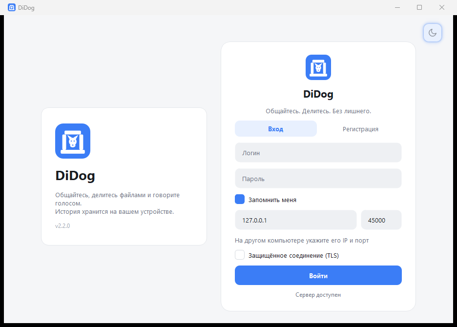
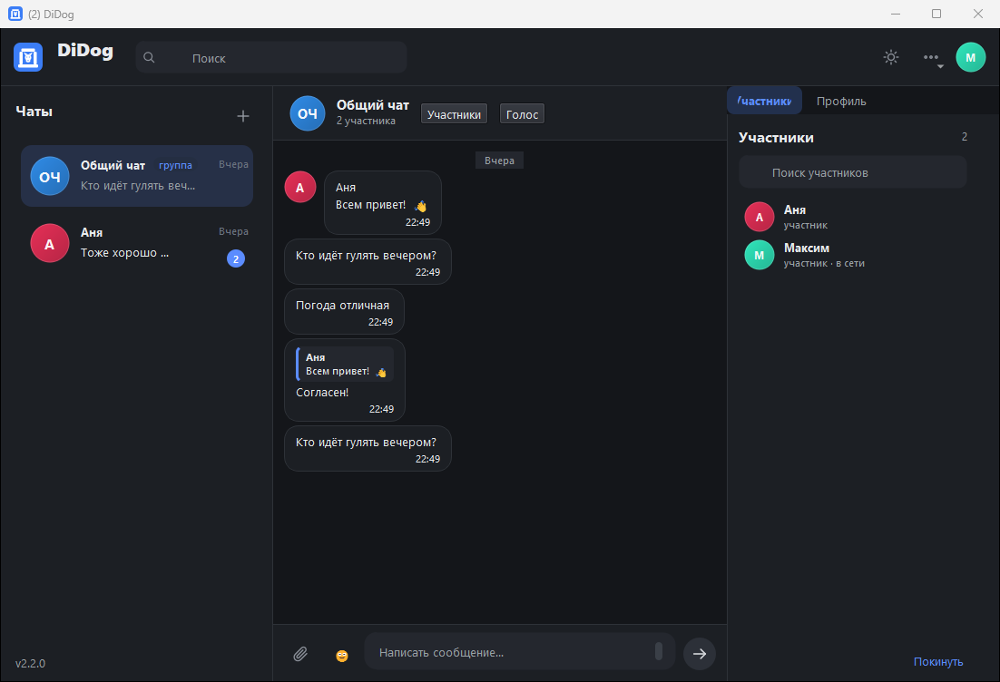

# MessengerApp

Кроссплатформенный десктопный мессенджер на Qt Widgets (C++17): регистрация и вход, личные и общий чат,
обмен текстом, фотографиями, GIF, видео и файлами, история в SQLite, современный интерфейс с двумя темами.

> Состояние: в разработке. Актуальный прогресс — в [docs/ROADMAP.md](docs/ROADMAP.md).

## Скриншоты

| Вход | Переписка (светлая) |
|---|---|
|  |  |

Тёмная тема:


## Возможности

Статус отражает реальное состояние кода (см. [docs/ROADMAP.md](docs/ROADMAP.md)).

| Готово | Функция |
|:---:|---|
| ✅ | Регистрация и вход, PBKDF2-хеширование паролей, сессии с токеном и автовосстановлением |
| ✅ | Список чатов: аватары, последнее сообщение, время, непрочитанные, поиск |
| ✅ | Пузыри сообщений, группировка, разделители дат, статусы sent/delivered/read |
| ✅ | Отправка в реальном времени, автоскролл, подгрузка истории, «печатает…», присутствие |
| ✅ | Локальная история в SQLite (отдельный поток), восстановление ленты после перезапуска |
| ✅ | Офлайн-очередь: сообщения уходят после восстановления связи без дублей |
| ✅ | Фото, GIF и файлы до 25 МБ: чанки, sha256, прогресс, кэш на получателе |
| ✅ | Светлая и тёмная темы с переключением на лету, fallback-аватары, анимация появления |
| ✅ | Логирование в файл, профили (`--profile`), защита от второго экземпляра |
| ⏳ | Видеоплеер, лайтбокс фото, «Сохранить как…» |
| ⏳ | Системный трей и уведомления |

## Стек

- **Язык:** C++17 (GCC ≥ 7.3, MSVC 2019+)
- **UI:** Qt Widgets + QSS (токены тем), SVG-иконки
- **Сеть:** `QTcpServer` / `QTcpSocket`, собственный бинарный протокол ([docs/protocol.md](docs/protocol.md))
- **БД:** SQLite через Qt SQL, драйвер QSQLITE, режим WAL
- **Медиа:** Qt Multimedia (`QMediaPlayer`, `QVideoWidget`), `QMovie`, `QImageReader`
- **Сборка:** CMake ≥ 3.16, presets

## Требования

| | Windows 10/11 | Linux (Ubuntu 22.04+) |
|---|---|---|
| Компилятор | MSVC 2019+ или MinGW GCC 7.3+ | GCC 9+ |
| Qt | 5.14.2+ (проверено на 5.14.2 и 5.15.2) | `qtbase5-dev`, `qtmultimedia5-dev`, `libqt5svg5-dev` |
| Прочее | CMake 3.16+, `windeployqt` | CMake 3.16+, `ninja`/`make` |

Модули Qt: `Core Gui Widgets Network Sql Multimedia MultimediaWidgets Concurrent Svg`.

Установка на Ubuntu:

```bash
sudo apt install build-essential cmake ninja-build \
    qtbase5-dev qtmultimedia5-dev libqt5svg5-dev qttools5-dev-tools \
    gstreamer1.0-plugins-good gstreamer1.0-plugins-bad gstreamer1.0-libav
```

> На Windows Qt Multimedia 5.x использует DirectShow: H.264/MP4 обычно воспроизводится, HEVC/AV1 может
> не проигрываться — клиент в этом случае предложит открыть файл внешним плеером.

## Сборка

Задайте путь к установленному Qt (каталог, где лежат `bin/`, `lib/`, `include/`), если он не в `PATH`:

```powershell
$env:QT_PREFIX = "C:\Qt\Qt5.14.2\5.14.2\mingw73_64"
```

### Windows, MinGW

```powershell
cmake -S . -B build -G "MinGW Makefiles" -DCMAKE_BUILD_TYPE=Release -DCMAKE_PREFIX_PATH="$env:QT_PREFIX"
cmake --build build -j 8
```

### Windows, MSVC

```powershell
cmake -S . -B build -G "Visual Studio 17 2022" -A x64 -DCMAKE_PREFIX_PATH="$env:QT_PREFIX"
cmake --build build --config Release
```

### Linux

```bash
cmake -S . -B build -DCMAKE_BUILD_TYPE=Release
cmake --build build -j"$(nproc)"
```

### Presets

```bash
cmake --preset windows-mingw     # или windows-msvc / linux-release
cmake --build --preset windows-mingw
```

Presets читают переменную окружения `QT_PREFIX`; при её отсутствии используется `CMAKE_PREFIX_PATH`/`PATH`.

## Запуск

1. Сервер:

   ```powershell
   .\build\MessengerServer.exe --port 45000
   ```

2. Два клиента (для проверки обмена):

   ```powershell
   .\build\MessengerClient.exe
   .\build\MessengerClient.exe --profile second
   ```

   Флаг `--profile` даёт отдельную папку данных — два клиента на одной машине не конфликтуют.

Либо одной командой: `scripts/run-demo.ps1` (Windows) или `scripts/run-demo.sh` (Linux).

Первый запуск создаёт БД, папки вложений и логов в:

- Windows: `%APPDATA%\MessengerApp\`
- Linux: `~/.local/share/MessengerApp/`

Переопределение: переменная окружения `MESSENGER_DATA_DIR` или флаг `--data <dir>`.

## Структура проекта

```
src/
├─ app/       точка приложения: пути данных, логирование, темы, настройки, single-instance
├─ core/      протокол и фрейминг, лимиты, коды ошибок, идентификаторы
├─ data/      SQLite: миграции, репозитории, транзакции, outbox
├─ security/  PBKDF2, токены, валидация ввода
├─ media/     определение типа, миниатюры, кэш вложений
├─ net/       клиентское соединение, реконнект, передача файлов
├─ server/    сервер: сессии, чаты, рассылка, хранилище вложений
└─ ui/        окна, модели списков, виджеты
resources/    QSS-темы, иконки, переводы
tests/        Qt Test: протокол, хеширование, БД, smoke-тест сервера
docs/         ТЗ, протокол, архитектура, план
```

## Документация

- [docs/TZ-v2.md](docs/TZ-v2.md) — техническое задание v2 (требования, схема БД, критерии готовности)
- [docs/protocol.md](docs/protocol.md) — спецификация сетевого протокола
- [docs/architecture.md](docs/architecture.md) — слои, потоки, жизненный цикл данных
- [docs/PROPOSAL.md](docs/PROPOSAL.md) — разбор исходного ТЗ и обоснование правок
- [docs/ROADMAP.md](docs/ROADMAP.md) — этапы и текущий прогресс

## Тесты

```bash
cmake -S . -B build -DBUILD_TESTING=ON
cmake --build build -j 8
cd build && ctest --output-on-failure
```

На Linux для headless-запуска GUI-тестов: `QT_QPA_PLATFORM=offscreen ctest`.

## Ограничения

- Трафик не шифруется (TLS не входит в объём): используйте в доверенной сети.
- Групповые чаты с управлением участниками, редактирование сообщений, реакции и звонки не реализуются.
- Qt 6 не поддерживается: медиа-API Qt 6 отличается, поддержка потребовала бы дублирования слоя.

## Лицензия

MIT — см. [LICENSE](LICENSE).
