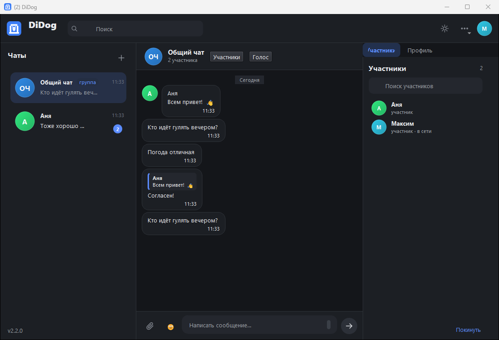
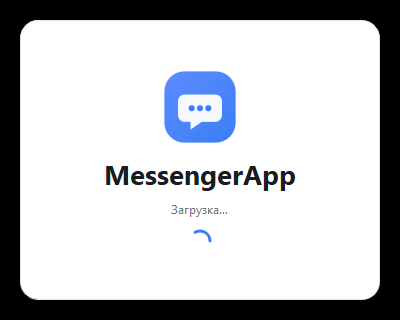
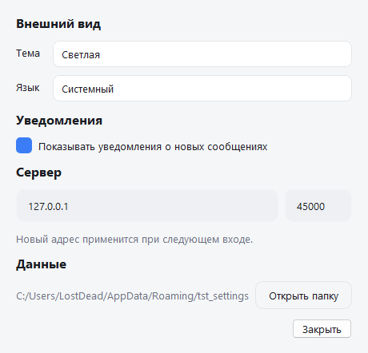

# DiDog (ДиДог)

Кроссплатформенный десктопный мессенджер на Qt Widgets (C++17): регистрация и вход, личные и общий чат,
обмен текстом, фотографиями, GIF, видео и файлами, история в SQLite, современный интерфейс с двумя темами.

DiDog — российская альтернатива Discord: чаты, группы, голосовые комнаты и звонки.
Логотип — собака в букве «Д».

> Состояние: в разработке. Актуальный прогресс — в [docs/ROADMAP.md](docs/ROADMAP.md).

## Скриншоты

| Вход | Главное окно (тёмная) |
|---|---|
|  |  |

| Светлая тема | Профиль справа |
|---|---|
|  |  |

| Стартовая заставка | Настройки |
|---|---|
|  |  |

## Возможности

Статус отражает реальное состояние кода (см. [docs/ROADMAP.md](docs/ROADMAP.md)).

| Готово | Функция |
|:---:|---|
| ✅ | Регистрация и вход, PBKDF2-хеширование паролей, сессии с токеном и автовосстановлением |
| ✅ | Список чатов: аватары, последнее сообщение, время, непрочитанные, поиск |
| ✅ | Пузыри сообщений, группировка, разделители дат, статусы sent/delivered/read |
| ✅ | Отправка в реальном времени, автоскролл, подгрузка истории, «печатает…», присутствие |
| ✅ | Локальная история в SQLite (отдельный поток), восстановление ленты после перезапуска |
| ✅ | Офлайн-очередь: сообщения уходят после восстановления связи без дублей |
| ✅ | Фото, GIF и файлы до 25 МБ: чанки, sha256, прогресс, кэш на получателе |
| ✅ | Лайтбокс фото, видеоплеер, «Сохранить как…» для файлов |
| ✅ | Системный трей с уведомлениями и счётчиком непрочитанных в заголовке |
| ✅ | Поиск по истории сообщений (Ctrl+F) с переходом в чат |
| ✅ | Интерфейс RU/EN, диалог настроек (тема, язык, уведомления, сервер, данные) |
| ✅ | Заглушка загрузки, тосты ошибок, горячие клавиши (Ctrl+F, Ctrl+N) |
| ✅ | Светлая и тёмная темы с переключением на лету, fallback-аватары, анимация появления |
| ✅ | Логирование в файл, профили (`--profile`), защита от второго экземпляра |
| ✅ | Портативный пакет Windows и CI для Windows/Ubuntu |
| ✅ | TLS-шифрование канала с закреплением отпечатка сертификата |
| ✅ | Служба Windows для сервера и развёртывание на VPS (systemd) |

## Стек

- **Язык:** C++17 (GCC ≥ 7.3, MSVC 2019+)
- **UI:** Qt Widgets + QSS (токены тем), SVG-иконки
- **Сеть:** `QTcpServer` / `QTcpSocket`, собственный бинарный протокол ([docs/protocol.md](docs/protocol.md))
- **БД:** SQLite через Qt SQL, драйвер QSQLITE, режим WAL
- **Медиа:** Qt Multimedia (`QMediaPlayer`, `QVideoWidget`), `QMovie`, `QImageReader`
- **Сборка:** CMake ≥ 3.16, presets

## Требования

| | Windows 10/11 | Linux (Ubuntu 22.04+) |
|---|---|---|
| Компилятор | MSVC 2019+ или MinGW GCC 7.3+ | GCC 9+ |
| Qt | 5.14.2+ (проверено на 5.14.2 и 5.15.2) | `qtbase5-dev`, `qtmultimedia5-dev`, `libqt5svg5-dev` |
| Прочее | CMake 3.16+, `windeployqt` | CMake 3.16+, `ninja`/`make` |

Модули Qt: `Core Gui Widgets Network Sql Multimedia MultimediaWidgets Concurrent Svg`.

Установка на Ubuntu:

```bash
sudo apt install build-essential cmake ninja-build \
    qtbase5-dev qtmultimedia5-dev libqt5svg5-dev qttools5-dev-tools \
    gstreamer1.0-plugins-good gstreamer1.0-plugins-bad gstreamer1.0-libav
```

> На Windows Qt Multimedia 5.x использует DirectShow: H.264/MP4 обычно воспроизводится, HEVC/AV1 может
> не проигрываться — клиент в этом случае предложит открыть файл внешним плеером.

## Установка на Windows (готовый установщик)

```powershell
.\scripts\build-installer.ps1          # Release + windeployqt + Inno Setup
```

Результат: `dist\installer\DiDog-Client-Setup-2.8.3.exe` (≈21 МБ). Что делает установщик:

- ставит приложение в `Program Files\MessengerApp` (или в профиль при `/CURRENTUSER`);
- добавляет ярлыки «MessengerApp» и «Сервер MessengerApp» в меню «Пуск» (и на рабочий стол по желанию);
- по галочке создаёт правило брандмауэра для сервера (профили «частная сеть» и «домен»);
- регистрирует штатное удаление, при деинсталляции правило брандмауэра удаляется.

Тихая установка для проверки:

```powershell
DiDog-Client-Setup-2.8.3.exe /VERYSILENT /CURRENTUSER /DIR="$env:LOCALAPPDATA\Programs\MessengerApp"
```

**Проверка на двух компьютерах и в разных сетях** — пошаговая инструкция:
[docs/NETWORK-TESTING.md](docs/NETWORK-TESTING.md). Коротко: на сервере запускается
«Сервер MessengerApp», он печатает свой адрес в локальной сети (`192.168.x.x:45000`),
этот адрес вводится в клиенте на втором компьютере.

## Безопасность соединения (TLS)

Сервер по умолчанию работает без шифрования. Включить TLS:

```powershell
.\MessengerServer.exe --tls
```

Сертификат берётся из `tls\server.crt` и `tls\server.key` рядом с сервером
(пути можно задать через `--tls-cert` и `--tls-key`). В комплекте идёт
демонстрационный самоподписанный сертификат; для реального использования
выпустите свой:

```powershell
.\scripts\make-cert.ps1 -OutputDir .\tls
```

В клиенте поставьте галочку **«Защищённое соединение (TLS)»**. При первом
подключении клиент запоминает SHA-256 отпечаток сертификата и сверяет его при
следующих подключениях; если сертификат сменился, соединение блокируется с
понятной ошибкой (защита от подмены сервера). Отпечаток выводится в логах
сервера при старте.

## Служба Windows

```powershell
# от имени администратора
cd "C:\Program Files\MessengerApp"
.\MessengerServer.exe --install-service --port 45000 --tls
```

Подробнее: [docs/WINDOWS-SERVICE.md](docs/WINDOWS-SERVICE.md). Установщик умеет
сделать это сам — галочка «Установить сервер как службу Windows».

## VPS (доступ из любых сетей)

```bash
sudo ./scripts/deploy-vps.sh
```

Скрипт собирает сервер, ставит его в `/opt/messengerapp`, генерирует сертификат,
создаёт systemd-службу с TLS и открывает порт. Пошагово и с диагностикой —
[docs/VPS-DEPLOY.md](docs/VPS-DEPLOY.md).

## Сервер по умолчанию и автоподключение

Клиент сам подключается к серверу при запуске и автоматически входит, если ранее
была отмечена галочка «Запомнить меня» (токен сессии хранится в профиле).

Адрес по умолчанию можно задать файлом `messenger.ini` рядом с `MessengerClient.exe`:

```ini
[network]
host=51.250.76.250
port=45000
tls=true
```

Файл используется, пока пользователь не сохранил свой адрес на экране входа.
Если сервер переехал, достаточно поправить `messenger.ini` или один раз ввести
новый адрес в клиенте.

## Вложения в истории

Вложения докачиваются при открытии чата, в том числе после перезапуска клиента
или на другом компьютере. Если загрузка не удалась (обрыв, таймаут), в пузыре
появляется «Не удалось загрузить. Нажмите, чтобы повторить» — клиент также
делает несколько автоматических повторов. Скачанные файлы кэшируются по sha256.

## Удаление чатов

Правый клик по чату в списке:

- **Удалить чат** — чат исчезает из списка, локальная история и вложения удаляются;
  у собеседника сообщения остаются. Новое сообщение вернёт чат в список.
- **Очистить историю** — удаляются только локальные сообщения, чат остаётся.

## Подписка и оформление

Промокод активируется в **Настройках → Подписка**. Код создаётся на сервере:

```powershell
.\MessengerServer.exe --add-promo WELCOME30:30:100
```

`CODE:DAYS[:MAX]` — срок подписки и лимит активаций (без лимита — не указывать).
После активации становятся доступны премиальные пакеты тем («Полночь», «Песок»)
в списке «Тема»; выбор сохраняется в профиле.

## Групповые чаты

Кнопка «+» в списке чатов → **«Новая группа…»**: название, поиск людей по имени
или логину, галочки участников. В шапке группы — кнопка **«Участники»**: аватары,
«в сети», роли (владелец, администратор, участник), поиск по именам.
Владелец и администраторы могут добавлять людей; «Покинуть группу» передаёт роль
следующему участнику.

## Обновления

Клиент проверяет обновления сам через несколько секунд после входа; вручную —
**Настройки → Обновления**. Скачиваются только изменённые файлы (сравнение sha256),
недокачанное продолжается с того же места. Применяет обновление
`MessengerUpdater.exe`: ждёт выхода клиента, делает бэкап, заменяет файлы и
перезапускает приложение.

Сервер раздаёт обновления из каталога `updates/` (`--updates-dir`); манифест
собирается скриптом `scripts\make-manifest.ps1 -Version 1.8.0`. Подробности —
[docs/UPDATER.md](docs/UPDATER.md).

## Голос

Голос идёт по UDP через сервер, звук шифруется **AES-256-GCM**; ключ комнаты
выдаётся по TLS. В настройках — push-to-talk и выбор микрофона/динамиков.
Подробности: [docs/VOICE-SECURITY.md](docs/VOICE-SECURITY.md).

Кнопка **«Голос»** в шапке чата звонит собеседнику: у него появляется окно
**«Принять / Отклонить»**, у звонящего — статус «Звоним…» и кнопка «Отменить».
После принятия звук идёт по **UDP** через сервер (Opus, 48 кГц, 20 мс кадры),
кнопка **«Микрофон»** выключает микрофон.

Для работы голоса на сервере должны быть открыты **TCP 45000** и **UDP 45001**
(в Yandex Cloud — правило в группе безопасности, на VPS — `ufw`). Порт UDP
меняется флагом `--voice-port`.

## Действия с сообщениями

Правый клик по сообщению:

- **Копировать текст** — в буфер обмена;
- **Изменить** — свои текстовые сообщения, у изменённых появляется «изм.»;
- **Удалить у всех** — только свои: у всех участников остаётся «Сообщение удалено»;
- **Удалить у себя** — скрывает сообщение только на этом компьютере.

## Документация

- [CHANGELOG.md](CHANGELOG.md) — все изменения по версиям (каждая правка фиксируется здесь)
- [docs/FEATURES.md](docs/FEATURES.md) — матрица функций: что есть, что дальше
- [docs/UI-CONCEPTS.md](docs/UI-CONCEPTS.md) — панель участников по макету и концепция личной странички
- [docs/VOICE-AND-SUBSCRIPTIONS.md](docs/VOICE-AND-SUBSCRIPTIONS.md) — план голосовых каналов и подписок

Правило проекта: изменение кода сопровождается записью в `CHANGELOG.md` и
обновлением затронутых файлов в `docs/`.

## Сборка

Задайте путь к установленному Qt (каталог, где лежат `bin/`, `lib/`, `include/`), если он не в `PATH`:

```powershell
$env:QT_PREFIX = "C:\Qt\Qt5.14.2\5.14.2\mingw73_64"
```

### Windows, MinGW

```powershell
cmake -S . -B build -G "MinGW Makefiles" -DCMAKE_BUILD_TYPE=Release -DCMAKE_PREFIX_PATH="$env:QT_PREFIX"
cmake --build build -j 8
```

### Windows, MSVC

```powershell
cmake -S . -B build -G "Visual Studio 17 2022" -A x64 -DCMAKE_PREFIX_PATH="$env:QT_PREFIX"
cmake --build build --config Release
```

### Linux

```bash
cmake -S . -B build -DCMAKE_BUILD_TYPE=Release
cmake --build build -j"$(nproc)"
```

### Presets

```bash
cmake --preset windows-mingw     # или windows-msvc / linux-release
cmake --build --preset windows-mingw
```

Presets читают переменную окружения `QT_PREFIX`; при её отсутствии используется `CMAKE_PREFIX_PATH`/`PATH`.

### Портативный пакет (Windows)

```powershell
$env:QT_PREFIX = "C:\Qt\Qt5.14.2\5.14.2\mingw73_64"
.\scripts\package-windows.ps1 -BuildDir build-release
```

Скрипт раскладывает `dist/MessengerApp` с зависимостями Qt, переводами и README —
папку можно переносить на машину без установленного Qt. Проверено запуском
без Qt в `PATH`.

### Непрерывная интеграция

[`.github/workflows/build.yml`](.github/workflows/build.yml) собирает и тестирует проект
на Ubuntu 22.04 (Qt 5.15, GCC) и Windows (Qt 5.15, MSVC 2019).

## Запуск

1. Сервер:

   ```powershell
   .\build\MessengerServer.exe --port 45000
   ```

2. Два клиента (для проверки обмена):

   ```powershell
   .\build\MessengerClient.exe
   .\build\MessengerClient.exe --profile second
   ```

   Флаг `--profile` даёт отдельную папку данных — два клиента на одной машине не конфликтуют.

Либо одной командой: `scripts/run-demo.ps1` (Windows) или `scripts/run-demo.sh` (Linux).

Первый запуск создаёт БД, папки вложений и логов в:

- Windows: `%APPDATA%\MessengerApp\`
- Linux: `~/.local/share/MessengerApp/`

Переопределение: переменная окружения `MESSENGER_DATA_DIR` или флаг `--data <dir>`.

## Структура проекта

```
src/
├─ app/       точка приложения: пути данных, логирование, темы, настройки, single-instance
├─ core/      протокол и фрейминг, лимиты, коды ошибок, идентификаторы
├─ data/      SQLite: миграции, репозитории, транзакции, outbox
├─ security/  PBKDF2, токены, валидация ввода
├─ media/     определение типа, миниатюры, кэш вложений
├─ net/       клиентское соединение, реконнект, передача файлов
├─ server/    сервер: сессии, чаты, рассылка, хранилище вложений
└─ ui/        окна, модели списков, виджеты
resources/    QSS-темы, иконки, переводы
tests/        Qt Test: протокол, хеширование, БД, smoke-тест сервера
docs/         ТЗ, протокол, архитектура, план
```

## Документация

- [docs/TZ-v2.md](docs/TZ-v2.md) — техническое задание v2 (требования, схема БД, критерии готовности)
- [docs/protocol.md](docs/protocol.md) — спецификация сетевого протокола
- [docs/architecture.md](docs/architecture.md) — слои, потоки, жизненный цикл данных
- [docs/PROPOSAL.md](docs/PROPOSAL.md) — разбор исходного ТЗ и обоснование правок
- [docs/ROADMAP.md](docs/ROADMAP.md) — этапы и текущий прогресс
- [docs/CHECKLIST.md](docs/CHECKLIST.md) — прогон чек-листа готовности с ограничениями среды
- [docs/NETWORK-TESTING.md](docs/NETWORK-TESTING.md) — проверка на разных компьютерах и в разных сетях
- [docs/VPS-DEPLOY.md](docs/VPS-DEPLOY.md) — сервер на VPS: systemd, TLS, обновления
- [docs/WINDOWS-SERVICE.md](docs/WINDOWS-SERVICE.md) — служба Windows для сервера

## Тесты

```bash
cmake -S . -B build -DBUILD_TESTING=ON
cmake --build build -j 8
cd build && ctest --output-on-failure
```

На Linux для headless-запуска GUI-тестов: `QT_QPA_PLATFORM=offscreen ctest`.

## Ограничения

- Трафик не шифруется (TLS не входит в объём): используйте в доверенной сети.
- Групповые чаты с управлением участниками, редактирование сообщений, реакции и звонки не реализуются.
- Qt 6 не поддерживается: медиа-API Qt 6 отличается, поддержка потребовала бы дублирования слоя.

## Лицензия

MIT — см. [LICENSE](LICENSE).
